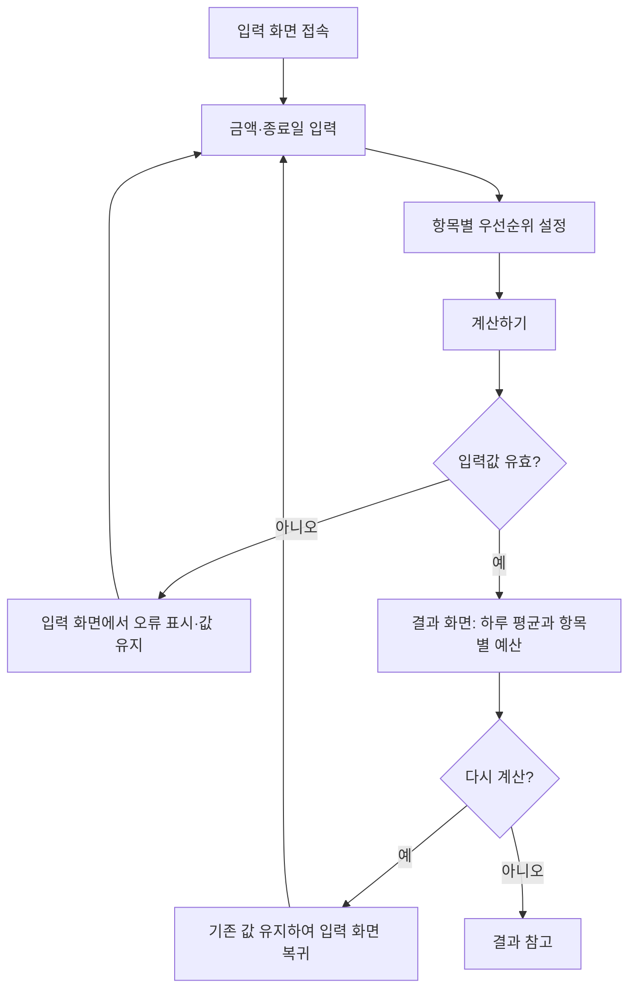
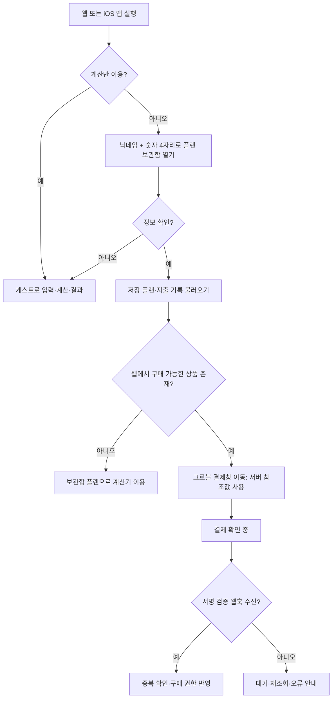
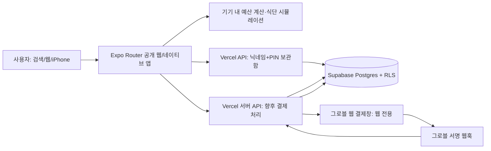

# PRD — 생활비 계산기 (웹 · iOS 서비스)

- **제품 형태:** 검색 가능한 모바일 우선 웹사이트 + iOS 네이티브 앱 (Expo Router 공통 코드베이스)
- **핵심 계산 화면:** 입력 화면, 생활비 플랜·지출 관리 결과 화면 (2개). 선택형 플랜 보관함·계정 관리·결제 관련 보조 화면은 별도.
- **동작 방식:** 예산 계산과 메뉴 시뮬레이션은 기기 내 규칙과 메뉴 목록으로 실행한다. 게스트 플랜은 현재 브라우저에 보관한다. 닉네임과 숫자 4자리로 플랜 1개와 지출 기록을 현재 브라우저에 저장하고 다시 불러온다. 다른 기기 간 전송과 클라우드 백업은 Later다. 메뉴 검색·담기에는 네트워크나 AI를 사용하지 않는다.
- **운영 목표:** 초기 1,000명 이하의 사용자; 웹은 Vercel, iOS는 App Store에 별도 출시.
- **개발 기준:** 이 문서의 기능·처리 규칙·완료 조건을 우선 적용한다. 기존 시각 와이어프레임은 레이아웃·색감 참고용이다.
- **미확정:** 판매할 상품/유료 기능/가격, iOS에서의 그로블 결제 허용 방식. 이 결정 전에는 유료 결제 버튼을 출시하지 않는다.

## 1. 서비스 개요

### 목적
대학생이 생활비 잔고, 다음 수입일까지의 종료일, 주당 외출일수와 **식비·교통비·여가비 비율**을 입력해 생활비 플랜을 만든다. 플랜을 저장한 뒤 실제 지출을 기록하면 남은 잔액과 기간에 맞춰 일일 한도 및 필요한 절약액을 다시 계산한다. 선택 날짜의 식비 한도 안에서 메뉴 목록을 검색하고 조합을 시뮬레이션한다.

### 핵심 사용자·문제·행동·결과

| 구분 | 내용 |
|---|---|
| 사용자 | 주당 외출일수가 달라지며 용돈이나 아르바이트 수입으로 생활하는 대학생 |
| 문제 | 남은 돈을 다음 수입일까지 식비·교통비·여가비에 얼마나 배분할지 판단하기 어려움 |
| 행동 | 배분 가능한 금액·종료일·주당 외출일수·분야별 비율을 입력해 계산하고 플랜 저장. 실제 지출을 항목별로 기록하고 메뉴를 조합해 봄 |
| 결과 | 항목별 플랜·외출일 교통 한도·실제 지출·누적 잔액·조정된 하루 한도·추가 절약액·식비 안에서 담은 메뉴 조합 |

**금액의 의미:** 입력 금액은 플랜 기간에 사용할 **고정지출 포함 전체 생활비**다. 등록한 고정지출을 이체 날짜에 반영하고, 전체 고정지출을 제외한 금액을 세 항목에 배분한다.

**핵심 계산 기능 범위 제외:** 계좌 연동, 여러 플랜의 보관·이력, 플랜 공유·링크 복사, 푸시 알림, AI 기능, 식당 검색·위치 추천, 실제 외출 요일·공휴일 일정 반영, 분석 대시보드. 계정 보관함은 한 번에 플랜 1개만 저장한다. 계산 전 입력 초안은 저장하지 않는다. 게스트 플랜은 현재 브라우저에만 저장하고, 사용자가 선택한 선택한 플랜과 지출 기록은 현재 브라우저에만 저장한다. 메뉴 시뮬레이터 조합은 실제 지출 기록으로 저장하지 않는다.

**신규 서비스 기능:** 이메일·소셜 로그인 없이 닉네임과 숫자 4자리로 간편 보관함을 만들고 플랜을 저장·복구한다. 사용자는 계정 보관함을 선택하지 않고도 게스트로 계산기를 이용할 수 있다. 계정 삭제와 향후 유료 기능의 구매 권한 관리를 제공한다. 그로블 웹 결제는 상품·가격 결정 및 iOS 정책 검토 후 활성화한다.

## 2. 기능 요구사항

| ID | 필수 기능 | 동작 |
|---|---|---|
| FR-01 | 금액 입력 | 고정지출을 포함한 전체 생활비를 원 단위 정수로 입력. 등록한 고정지출을 먼저 제외한 뒤 세 항목에 배분 |
| FR-02 | 종료일 선택 | 오늘부터 최대 365일 후까지 선택. **다음 수입일 전날**을 선택하도록 안내 |
| FR-03 | 분야별 비율 조절 | 식비·교통비·여가비 비율을 0~100% 슬라이더로 조절. 기본값은 식비 50%·교통비 30%·여가비 20% |
| FR-04 | 비율 합계 자동 조정 | 한 분야 비율을 바꾸면 나머지 두 분야 비율을 기존 비율에 맞춰 자동 조정해 합계 100%를 유지. 각 분야는 0%로 설정 가능 |
| FR-05 | 비율 공개 | 입력과 결과에서 각 분야 비율·총액을 표시. 원 단위 나머지는 가장 높은 비율 분야에 더해 항목별 합계를 보존 |
| FR-06 | 계산하기 | 클릭하면 입력 유효성 검사 후 정상일 때만 결과 화면 표시. 오류 시 입력 화면 유지 |
| FR-07 | 결과 표시 | 기간·일수, 전체 하루 평균, 항목별 순위·비율·총액·하루 평균 표시 |
| FR-08 | 결과 안내 | **권장 예산**임을 강조하고, 오늘·주말·공휴일 포함 평균이며 필수 비용을 보장하지 않음을 안내 |
| FR-09 | 다시 계산하기 | 입력 화면으로 돌아가 직전 금액·날짜·순위를 유지하고 수정 가능 |
| FR-10 | 오류 복구 | 문제가 있는 필드 아래 구체적 오류 안내, 첫 오류 필드로 포커스 이동, 다른 입력값 유지 |
| FR-11 | 뒤로 가기 | 결과에서 브라우저 뒤로 가기를 사용하면 입력 화면으로 돌아오며 현재 탭의 입력값 유지 |
| FR-12 | 날짜 변경 감지 | 결과를 열어 둔 채 한국 날짜가 바뀌면 기존 계산이 오래되었음을 안내하고 재계산 유도 |
| FR-13 | 게스트 사용 | 보관함을 만들지 않아도 입력·계산·플랜 저장·지출 기록·메뉴 시뮬레이션 가능. 게스트 플랜과 지출 기록은 현재 브라우저에만 보관하고 서버에 전송하지 않음 |
| FR-14 | 닉네임 보관함 만들기·열기 | **이 플랜 저장하기**에서 닉네임과 숫자 4자리 PIN을 만들고 현재 브라우저에 플랜을 저장한다. 메인 화면의 저장 플랜 블록을 누르면 두 정보를 입력해 플랜을 불러온다. |
| FR-15 | 보관 플랜 지출 기록 | PIN으로 불러온 플랜에서 실제 지출을 추가·삭제하고 현재 브라우저 보관함에 반영한다. 닉네임별 플랜은 1개다. |
| FR-16 | 공개 페이지 SEO | 계산기 진입 페이지의 정적 HTML·제목·설명·canonical·robots.txt·sitemap.xml 제공; 사적 결과·계정 페이지는 noindex |
| FR-17 | 그로블 결제 준비 | 웹에서만 그로블 결제창 연결을 설계. 서버가 임의 참조값을 생성하여 주문에 연결하고 서명 검증 웹훅을 수신 |
| FR-18 | 결제 권한 반영 | 검증된 결제 완료에만 구매 권한 부여, 환불·구독 종료·결제 실패 시 권한 갱신, 중복 웹훅 멱등 처리 |
| FR-19 | 결제 대기·오류 | 결제 후 복귀만으로 구매 완료 처리하지 않음. 서버 확정 전 '결제 확인 중', 실패/지연/중복 알림 제공 |
| FR-20 | iOS 배포·정책 | iOS 네이티브 빌드 제공. 제3자 디지털 결제 허용 경로 미승인 시 iOS 결제·외부결제 유도 CTA 비활성화 |
| FR-21 | 주당 외출일수 | 주 1~7일의 정수를 입력. 입력한 주당 평균으로 남은 기간의 예상 외출일과 외출 1일 교통 한도를 계산 |
| FR-22 | 생활비 플랜 저장 | 게스트는 계산 결과에서 **플랜 저장**을 선택해 현재 브라우저에 저장한다. 계정 사용자는 닉네임/PIN을 만들어 현재 브라우저에 플랜 1개와 지출 기록을 저장한다. 기존 플랜을 교체할 때 확인한다. |
| FR-23 | 실제 지출 기록 | 저장 플랜에서 날짜·식비/교통비/여가비 항목·금액을 입력해 실제 지출을 추가한다. 게스트는 브라우저에, 닉네임 보관함은 현재 브라우저에 저장한다. 기록 삭제 가능 |
| FR-24 | 실시간 남은 예산 재계산 | 지출 추가·삭제 즉시 실제 합계, 잔액, 남은 일일 한도, 외출일 교통 한도와 추가 절약액을 갱신한다. 목표보다 초과한 금액은 비율이 낮은 항목의 남은 일일 한도부터 줄임 |
| FR-25 | 고정지출 일정 입력 | 플랜을 만들 때 고정지출을 0건 이상 등록하고 각 금액과 이체 날짜를 지정 |
| FR-26 | 날짜별 예산 카드 | 플랜 기간 날짜를 가로 스크롤 카드로 표시하고 접속 날짜 카드를 자동 선택 |
| FR-27 | 날짜별 분야별 잔액 | 선택한 날짜 카드에 분야별 그날 가용 금액·실제 지출 후 남은 금액, 해당 날짜의 고정지출, 시작 금액에서 해당 날짜까지의 누적 가용액·고정지출·실제 지출을 반영한 잔액 표시. 플랜 마지막 날 잔액은 0원 |
| FR-28 | 식단 시뮬레이터 | 선택 날짜의 남은 식비를 보여주고 고정 메뉴 목록을 분야별로 검색·필터링한다. 메뉴를 담거나 빼며 선택 수·합계·식비 초과 여부를 즉시 표시하고 예산 이하 메뉴만 보기를 제공한다. 메뉴 조합은 선택 날짜별 화면 상태에만 보관하며 지출 기록으로 저장하지 않는다. 인터넷·서버·AI 호출은 하지 않고 메뉴와 예상 가격은 참고값임을 알린다. |

## 3. 화면 구성

### 공통 흐름

**별도 계정·결제 흐름(핵심 계산 흐름을 막지 않음)**

> 유료 상품과 혜택은 미정이다. iOS 결제는 Apple 정책·결제 제공업체 승인 완료 전까지 위의 웹 구매 경로와 별도로 비활성화한다. 

### 화면 1 — 입력

1. 서비스명: **생활비 계산기**
2. 헤드라인: **돈 없어 미치겠다!!! 어떻게 버텨야 하지?**
3. 설명: **남은 생활비를 기준으로 식비·교통비·여가비 계획을 세워요.**
4. 금액 입력: 라벨 **고정지출을 포함한 전체 생활비**, 힌트 **고정지출 금액과 이체 날짜를 입력하면, 이체 예정 금액을 제외하고 식비·교통비·여가비를 계산해요.** 단위 원
5. 종료일: 라벨 **이 돈을 언제까지 쓸 건가요?**, 힌트 **12월 4일에 용돈을 받는다면 12월 3일을 선택하세요.**
6. 주당 외출일수: **주당 외출일수** 1~7일 정수 입력. 학교·아르바이트·약속 등 일주일 평균 외출일로 보고 실제 요일·공휴일은 반영하지 않음을 안내
7. 고정지출 입력: 고정지출별 금액과 이체 날짜를 등록하고 항목을 추가·삭제
8. 예산 비율 조절: 식비·교통비·여가비의 0~100% 슬라이더와 현재 비율을 표시. 한 비율을 움직이면 나머지 두 비율을 비례 조정해 합계 100%를 유지
9. 주 버튼: **계산하기** (클릭 시 유효성 검사)
10. 오류: 각 문제 필드 근처에 구체적인 메시지를 표시하고 첫 오류에 초점을 이동. 다른 입력값은 유지

**초기 상태:** 금액·종료일·주당 외출일수는 비어 있음. 비율만 기본값 설정. 예시 숫자를 실제 입력값으로 채우지 않음.

### 화면 2 — 생활비 플랜·지출 관리 결과

1. 헤더: **생활비 플랜**, 플랜 시작일~종료일 및 전체·남은 일수
2. 날짜 카드 목록: 플랜 날짜를 가로 스크롤로 표시하고 접속한 한국 날짜 카드를 자동 선택
3. 날짜 카드 항목: 식비·교통비·여가비별 그날 가용 금액과 실제 지출을 반영한 남은 금액 표시
4. 선택 날짜에 이체할 고정지출 금액과 해당 날짜까지 누적 가용액·고정지출·실제 지출을 반영한 남은 잔액 표시. 잔액은 날짜가 지날수록 줄고 마지막 날 0원
5. 전체·남은 일수, 하루 총 권장 한도, 실제 지출 합계, 예상 외출일수와 외출 1일 교통 한도도 표시
6. 항목 카드 3개: 비율이 높은 순서로 **항목명 / 적용 비율 / 플랜 금액 / 실제 지출 / 남은 기간 하루 한도** 표시
7. 플랜이 아직 저장되지 않았다면 **플랜 저장** 버튼을 표시. 저장된 플랜은 지출 추가·삭제 때 브라우저에 즉시 반영
8. 지출 입력: 날짜(기본 오늘), 항목, 금액 및 **지출 추가** 버튼. 저장 플랜에 한해서 표시
9. 지출 목록: 기록 날짜·항목·금액과 각 기록 삭제 버튼
10. 목표 속도보다 초과 지출한 경우: **남은 N일 동안 하루 X원씩 더 절약해야 합니다**와 낮은 우선순위부터 조정된 항목 한도를 표시
11. 고정 안내: 평균 권장 예산이며 필수 비용 충족이나 실제 지출을 자동으로 알 수 있음을 보장하지 않음. 게스트 데이터는 이 브라우저에, 보관함을 선택한 데이터는 계정에 저장됨
12. **다시 계산하기**로 돌아가 직전 입력값을 수정. 저장 플랜 교체는 확인 후 적용
13. 계산 기준일이 바뀐 경우: 기존 계산이 오래되었음을 안내하고 재계산 유도
14. **오늘의 식단 시뮬레이터**에 담긴 메뉴 수·합계·선택 날짜의 남은 식비를 표시. 메뉴 분야 필터와 이름 검색, 식비 한도 안 메뉴만 보기, 메뉴 담기·빼기를 제공하고 예산 초과 여부를 즉시 계산

### 화면 참고 자료

> **구현 우선순위:** 본 문서의 화면 명세·처리 규칙이 이미지보다 우선한다. 이미지에는 이전 버전의 잘못된 연도 표기와 MVP 범위 밖인 **결과 링크 복사** 버튼이 있으므로 구현하지 않는다. 결과 문구는 **하루 사용 가능 금액** 대신 **하루 평균 권장 예산**을 사용한다.

### 보조 화면·상태 — 신규 요구사항

- **간편 플랜 보관함:** 새 보관함 만들기 또는 기존 보관함 불러오기. 닉네임과 숫자 4자리 입력, 게스트로 계속하기를 제공하며 이메일·소셜 계정은 요구하지 않음.
- **보관함 관리:** 현재 플랜·지출 기록 저장, 불러오기, 보관함 삭제 및 삭제 재확인. 결제 내역·권한 상태는 실제 상품이 정의된 경우에만 제공.
- **웹 결제 진입·결제 확인 화면:** 유료 상품·가격·혜택 결정 후 웹에 노출. 구매자는 그로블 결제창으로 이동하며, 귀환 즉시 구매 확정하지 않고 서버 웹훅 확인 상태를 보여줌.
- **iOS:** 계산과 계정 관리는 네이티브 UI를 사용하고, 디지털 유료 기능 결제 관련 버튼은 Apple의 허용 경로 승인 전 노출하지 않음.
- **화면 수 해석:** 종전 2개 화면 제한은 **핵심 계산 흐름**에만 적용한다. 필수 인증·계정 삭제·결제·법적 고지 등 보조 UI는 운영 서비스에서 별도로 존재할 수 있다.

### 화면·접근성 공통 조건

- 최소 320px 화면 폭에서 가로 스크롤 없이 입력·결과 확인 가능
- 금액 입력은 모바일 숫자 키패드 지원, 입력 라벨은 항상 보이도록 표시
- 모든 항목을 키보드와 보조기술로 조절 가능; Tab 이동 순서는 금액→날짜→외출일수→예산 비율 슬라이더→계산 버튼
- 오류는 색상 외에 텍스트로도 안내하고 해당 필드와 접근성 속성으로 연결
- 예산 비율 변경 결과와 합계 100% 자동 조정은 시각적으로 즉시 반영하고 보조기술에도 전달

## 4. 처리 규칙

### 입력·날짜 정책

| 변수 | 정책 |
|---|---|
| `amount` | **1~100,000,000원** 사이 정수. 쉼표·앞뒤 공백은 제거 후 검증; 음수·소수·문자·지수 표기 불가 |
| `endDate` | `YYYY-MM-DD`, **오늘~오늘+365일** 범위, 날짜 선택 필수 |
| `priorities` | 분야별 0~100 정수 비율이며 세 항목의 합은 정확히 100% |
| `outingDaysPerWeek` | 1~7 사이 정수. 학교·일·약속 등을 포함한 주당 평균 외출일수 |
| `fixedExpenses` | 0건 이상의 1회성 고정지출. 각 항목은 금액과 플랜 기간 안의 이체 날짜를 가진다 |
| `today` | **계산 버튼을 누른 시점의 `Asia/Seoul` 날짜** |
| `days` | `today`부터 `endDate`까지 **양 끝 날짜 포함** 일수. 오늘 종료 시 1일 |

### 계산 알고리즘

1. `days`는 플랜 시작일(계산 시점의 `Asia/Seoul` 날짜)부터 종료일까지 양 끝 날짜를 포함한 달력 일수로 계산한다.
2. `flexibleAmount = amount - sum(fixedExpenses.amount)`. 사용자가 설정한 세 분야 비율을 이 금액에 적용하고 원 단위 나머지는 가장 높은 비율 분야에 더한다. 항목별 총액 합은 `flexibleAmount`와 정확히 같아야 한다.
3. `expectedOutingDays = round(remainingCalendarDays × outingDaysPerWeek / 7)`. 외출일은 주간 평균으로 추정하며 특정 요일·공휴일을 계산하지 않는다.
4. 저장 시점에만 플랜 초깃값을 현재 브라우저 저장소에 기록한다. 플랜 저장 후에는 지출을 더하거나 삭제할 때마다 지출 목록과 합계를 즉시 다시 저장한다.
5. `flexibleAmount = amount - sum(fixedExpenses.amount)`. `remainingAmount = flexibleAmount - actualSpentTotal`; `remainingDaily = floor(max(0, remainingAmount) / remainingCalendarDays)`로 계산한다. 남은 날짜는 오늘부터 종료일까지 포함한다.
6. `plannedDaily = floor(flexibleAmount / totalPlanDays)`. `extraDailySavings = max(0, plannedDaily - remainingDaily)`로 계산해 초과 지출을 남은 기간에 분산해 보여준다. 예산 초과 상태에서는 남은 한도를 0원으로 표시하고 초과액도 따로 안내한다.
7. 항목별 기본 하루 한도는 항목 총액을 전체 플랜 일수로 나눈 값이다. 실제 지출로 전체 하루 한도가 줄어들면 비율이 낮은 항목부터 적용한다. 항목별 표시액 합계의 원 단위 차이는 가장 높은 비율 항목에서 조정한다.
8. `remainingExpectedOutingDays = round(remainingCalendarDays × outingDaysPerWeek / 7)`. 남은 교통 한도를 예상 외출일수로 나눠 외출 1일 권장 교통 한도를 계산한다. 남은 예상 외출일이 0이면 외출일 한도 대신 해당 기간에 외출일이 없다고 표시한다.
9. 고정지출은 지정한 날짜에 한 번 이체되는 것으로 처리한다. 같은 날짜의 고정지출은 합산해 카드에 표시하고, 해당 날짜부터 잔액에서 차감한다.
10. 날짜별 카드 잔액은 `max(0, amount - fixedPaidThroughDate - actualSpentThroughDate - allocatedDailyBudgetThroughDate)`로 계산한다. 날짜별 가용 예산은 하루씩 누적 반영하므로 플랜 마지막 날짜 잔액은 0원이다.
11. 메뉴 시뮬레이터는 앱에 포함된 고정 메뉴·가격 목록만 사용한다. 검색·필터·메뉴 선택과 합계 계산은 기기에서 처리하며 외부 서버에 보내거나 실제 지출로 기록하지 않는다.
10. 분야별 총예산을 플랜 날짜에 나누어 날짜 카드에 표시한다. 원 단위 나머지는 앞 날짜부터 1원씩 더해 날짜별 합계가 분야별 총예산과 일치하게 한다.
11. 카드별 분야 잔액은 해당 날짜까지 입력된 실제 지출을 분야별 총예산에서 뺀 값이다. 카드의 예산 반영 후 잔액은 전체 금액에서 해당 날짜까지의 고정지출 이체액·실제 지출액·그날 분야별 미사용 가용 금액을 뺀다. 가용 예산은 실제 지출로 기록되기 전까지 현금 지출로 중복 차감하지 않는다.
12. 총액·일일 한도·외출일 한도·날짜별 카드 수치는 모두 기기에서 계산하며, 서버로 전송하지 않는다. 계정 보관함 저장은 사용자가 선택한 플랜과 지출 기록만 서버로 보낸다.

**중요:** `50:30:20`은 임시 배분 규칙이다. 실제 필수 교통비·식비를 충족하는지 계산하지 않는다. 사용자는 7일 기준 평균값을 평일 전용 한도로 이해하지 않도록 안내받아야 한다.

### 정상 예시

- 오늘: **2026-11-18** / 종료일: **2026-12-03** / 금액: **300,000원** / 일수: **16일**
- 우선순위: 식비 1위, 교통비 2위, 여가비 3위
- 결과: 식비 **150,000원(하루 9,375원)**, 교통비 **90,000원(하루 5,625원)**, 여가비 **60,000원(하루 3,750원)**
- 전체 하루 평균: **18,750원**

### 오류·상태 관리

| 상황 | 동작 및 안내 |
|---|---|
| 금액 비어 있음 | **세 항목에 나눌 금액을 입력해 주세요.** |
| 금액 0·음수·소수·문자 | **1원 이상의 정수 금액을 입력해 주세요.** |
| 금액 1억 원 초과 | **1억 원 이하로 입력해 주세요.** |
| 종료일 비어 있음 | **언제까지 사용할지 날짜를 선택해 주세요.** |
| 종료일 과거 | **오늘 또는 그 이후 날짜를 선택해 주세요.** |
| 종료일 365일 초과 | **오늘부터 365일 이내의 날짜를 선택해 주세요.** |
| 종료일 오늘 | 정상 계산, `days = 1` |
| 주당 외출일수 비어 있거나 1~7 정수가 아님 | 주당 외출일수를 1~7 사이 정수로 입력하도록 안내 |
| 고정지출 금액이 비어 있거나 정수가 아님 | 고정지출 금액 오류를 입력 영역에 안내하고 계산하지 않음 |
| 고정지출 합계가 전체 생활비보다 큼 | 고정지출 합계 오류를 안내하고 계산하지 않음 |
| 고정지출 이체일이 오늘 전이거나 플랜 종료일 이후 | 이체 날짜 오류를 안내하고 계산하지 않음 |
| 순위 중복 시도 | 자동 맞교환 및 변경된 순위 안내 |
| 지출 금액이 1원 미만·소수·문자 | 구체적인 오류를 표시하고 기록하지 않음 |
| 지출 기록 추가·삭제 | 저장 플랜과 지출 합계·남은 한도를 즉시 갱신하고 브라우저 저장소에 반영 |
| 지출 총액이 플랜 금액 초과 | 남은 한도 0원, 초과액 및 남은 기간 기준 추가 절약 안내 |
| 저장된 플랜 교체 | 기존 플랜과 지출 목록을 바꾸기 전에 확인 |
| 결과→다시 계산/뒤로 가기 | 같은 탭에서 입력값을 유지하고 입력 화면으로 복귀 |
| 저장 플랜 재방문 시 한국 날짜 변경 | 날짜 변경과 오래된 계산을 안내하고 남은 기간을 다시 계산 |
| 브라우저 저장 데이터 삭제 | 플랜과 지출 기록을 복원할 수 없음을 안내 |

- 금액·종료일·주당 외출일수 검증은 **계산하기 클릭 시** 수행한다. 타이핑 중 매 키 입력마다 오류를 띄우지 않는다.
- 정상 계산과 지출 재계산은 웹 브라우저 또는 iOS 기기에서 실행한다. **계산 API를 호출하지 않는다.**
- 게스트 플랜은 사용자가 **플랜 저장**을 눌러 현재 브라우저에 확정한다. 보관함 저장은 사용자가 결과 화면에서 저장을 선택해야 시작된다. 저장 전 입력 초안은 보관하지 않는다. 저장 후 지출 추가·삭제는 선택한 보관함에 반영한다.
- 플랜 보관함은 닉네임과 숫자 4자리로 이 브라우저에서 현재 플랜 1개와 지출 기록을 불러온다. 다른 기기에서는 복원되지 않는다. 기존 브라우저 데이터와 계정 데이터가 다르면 덮어쓰기 전에 확인한다.
- 4자리 PIN은 평문으로 저장하거나 기록하지 않는다. 계정 접근은 서버에서 확인하고, 반복 오입력에는 간단한 시도 제한과 잠시 기다리기 안내를 둔다. 다중 인증이나 고강도 계정 복구는 이번 범위에 포함하지 않는다.
- 닉네임/PIN 보관함은 현재 브라우저 저장소를 사용한다. PIN은 평문으로 저장하지 않는다. 클라우드 동기화와 복구는 Later다.
- 서버에서 승인되지 않은 유료 권한은 앱·웹 클라이언트 표시만으로 부여할 수 없다. DB Row Level Security(RLS)를 통해 사용자별 읽기/쓰기 권한을 검증한다.
- 결제 웹훅은 원본 요청 본문 기준 HMAC-SHA256 서명, 타임스탬프 허용 오차(±5분), 중복 방지 키를 확인한 뒤 처리한다. 웹훅 키/관리자 키는 서버 환경변수에만 보관한다.
- 결과 화면은 유효한 계산 데이터가 있을 때만 열 수 있다. 직접 접근하거나 상태가 소실된 경우 입력 화면으로 복귀시킨다.

## 5. 완료 조건

### 개발 인수 조건

- [ ] **AC-01** 입력 화면에서 금액이 고정지출 포함 전체 생활비임을 확인하고, 고정지출 합계를 먼저 뺀 뒤 세 분야에 배분함을 알 수 있다.
- [ ] **AC-02** 종료일 선택 시 다음 수입일 전날을 고르도록 안내한다.
- [ ] **AC-03** 세 비율 슬라이더를 0~100%로 조절할 수 있고, 어느 분야를 0%로 설정해도 합계가 자동으로 100%를 유지한다.
- [ ] **AC-04** 정상 입력 시 결과 화면에 기간·일수·전체 하루 평균·세 항목의 비율·총액·하루 평균이 모두 표시된다.
- [ ] **AC-05** 분야별 총예산 합은 입력한 전체 생활비에서 고정지출 합계를 뺀 금액과 정확히 일치한다.
- [ ] **AC-06** 빈 금액·잘못된 금액·과거/범위 초과 날짜는 오류로 안내하고 입력값을 보존한다.
- [ ] **AC-07** **다시 계산하기** 또는 브라우저 뒤로 가기로 입력 화면에 돌아와 값을 수정할 수 있다.
- [ ] **AC-08** 결과 화면에서 예산의 '권장' 성격·주말 포함·필수 비용 미보장 안내가 보인다.
- [ ] **AC-09** 날짜 경계·윤년·한국 시간 자정 변경을 올바르게 처리한다.
- [ ] **AC-10** 모바일 320px 폭, 키보드 조작, 오류 메시지 접근성을 확인한다.
- [ ] **AC-11** 핵심 화면은 입력과 생활비 플랜·지출 관리 결과 2개다. 메뉴 시뮬레이터는 기기 안의 목록으로 동작하며 AI·계좌 연동·여러 플랜 이력·공유·소비 분석 기능은 없다. 선택형 간편 플랜 보관함과 결제 UI는 별도다.
- [ ] **AC-18** 주당 외출일수 1~7 입력에 따라 예상 외출일수와 교통 1일 한도가 표시되고, 0 또는 범위 밖 값은 계산을 막는다.
- [ ] **AC-19** 플랜 저장을 선택한 뒤 새로고침해도 현재 브라우저에서 플랜과 지출 기록이 유지된다.
- [ ] **AC-20** 실제 지출을 추가·삭제하면 합계·남은 잔액·남은 하루 한도·외출일 한도·추가 절약액이 즉시 갱신된다.
- [ ] **AC-21** 초과 지출 시 추가 절약액과 낮은 우선순위부터 줄인 조정 한도를 확인할 수 있다.
- [ ] **AC-22** 예산 계산과 메뉴 검색·조합은 기기 안에서 처리된다. 게스트 플랜은 브라우저에 저장되고, 계정 보관함을 선택한 경우에만 현재 플랜과 실제 지출 기록이 서버로 저장된다. 메뉴 조합은 실제 지출 목록에 자동 추가되지 않는다.
- [ ] **AC-23** 고정지출을 0건 이상 입력할 수 있고, 금액·이체 날짜가 유효하며 합계가 전체 생활비 이하여야 계산된다.
- [ ] **AC-24** 플랜 기간 날짜가 가로 스크롤 카드로 표시되고, 플랜 기간 안의 오늘 카드가 자동 선택된다.
- [ ] **AC-25** 날짜 카드의 잔액은 날짜가 지날 때마다 누적 가용 예산·고정지출·실제 지출만큼 감소하며 플랜 마지막 날에는 0원이다.
- [ ] **AC-12** 웹 공개 진입 페이지가 배포된 URL에서 실제 HTML 제목/설명·정적 콘텐츠·사이트맵·robots·canonical을 제공하고 Google Search Console에 사이트맵을 제출할 수 있다. 검색 순위/노출을 보장하지는 않는다.
- [ ] **AC-13** 닉네임·숫자 4자리로 보관함을 만들고 다시 열어 플랜·지출을 복원한다. 반복 PIN 오입력은 일시 제한되고 게스트 계산은 계속 가능하다.
- [ ] **AC-14** 앱에서 계정 보관함 삭제가 가능하고 저장된 플랜·지출이 삭제된다. 삭제 후 해당 보관함에 접근할 수 없다.
- [ ] **AC-15** 결제 기능 출시 시, 그로블 서명 웹훅으로만 유료 권한을 부여하며 중복·환불·결제 지연·실패 시나리오를 검증한다.
- [ ] **AC-16** iOS 네이티브 화면이 작동하고 TestFlight 및 App Store 제출 준비를 완료한다. 한국 디지털 결제 허용 요건 충족 전에는 iOS 외부 결제 CTA를 노출하지 않는다.
- [ ] **AC-17** Vercel 운영 플랜이 상업적 사용 정책에 부합하고 비밀키가 앱 번들·공개 Git 저장소에 포함되지 않는다.
- [ ] **AC-26** 메뉴 분야 필터·이름 검색·예산 이하 보기·메뉴 담기/빼기가 작동한다. 선택 메뉴 수와 합계, 한도 이내/초과 상태가 즉시 바뀐다. 메뉴 선택은 선택 날짜별 화면 상태에만 남고 지출 기록으로 저장되지 않는다.

### 필수 QA 테스트

| ID | 입력 및 행동 | 예상 결과 |
|---|---|---|
| T-01 | 2026-11-18~12-03 / 300,000원 / 식비→교통비→여가비 | **16일**, 하루 **18,750원**, 총액 **150,000 / 90,000 / 60,000원** |
| T-02 | 100,001원 / 종료일 오늘 | **1일**, **50,000 / 30,000 / 20,001원**, 합계 일치 |
| T-03 | 교통비 비율을 0%로 드래그 | 교통비 0%, 나머지 비율 자동 조정, 합계 100% 유지 |
| T-04 | 금액 공란·0·소수·음수·문자·상한 초과 | 적절한 인라인 오류, 다른 입력값 보존 |
| T-05 | 종료일 공란·어제·366일 후 | 오류 후 화면 1 유지, 날짜 수정 가능 |
| T-06 | 종료일 오늘 / 2026-12-31~2027-01-01 | 각각 **1일 / 2일** |
| T-07 | 2028-02-28~2028-03-01 | 윤년 기준 **3일** |
| T-08 | 1,000원 / 3일 | 전체 하루 **333원**, 항목별 합 **332원**, 항목 **총액** 합은 1,000원 |
| T-09 | 1원 / 16일 | 전체 하루 평균 **1원 미만**, 총액 1원 보존 |
| T-10 | 결과→다시 계산→수정→재계산, 브라우저 뒤로 가기 | 직전 값 유지, 새로운 결과로 정확히 갱신 |
| T-11 | 결과 화면을 다음 한국 날짜에 다시 활성화 | 이전 계산 경고, 재계산 가능 |
| T-12 | 모바일 320px·키보드·스크린리더 점검 | 가로 스크롤 없음, 모든 컨트롤·오류 안내 접근 가능 |
| T-13 | 검색엔진 크롤러로 웹 공개 페이지 조회 | 렌더된 HTML 제목·본문·설명 확인, 공개 URL만 사이트맵 포함 |
| T-14 | 닉네임·숫자 4자리 보관함 생성 후 다시 입력 | 플랜과 실제 지출이 복원되고 게스트 계산도 가능 |
| T-15 | 탈퇴 후 로그아웃·재접근 | 삭제 요청 처리, 삭제 계정 데이터 보호, 재접근 차단 |
| T-16 | 위조 서명·만료 타임스탬프·중복 웹훅 | 권한 미발급 또는 중복 반영 방지 |
| T-17 | 결제 성공 복귀 페이지가 웹훅보다 먼저 로드 | `결제 확인 중` 안내, 웹훅 반영 후 권한 표시 |
| T-18 | 결제 환불·구독 갱신 실패·종료 이벤트 | 권한 정책에 따라 정확히 갱신, 주문 이력 추적 |
| T-19 | iOS 앱 실기기 및 심사 준비 | 네이티브 UI·로그인·접근성 확인, 승인 전 외부 디지털 결제 버튼 없음 |
| T-20 | 300,000원 / 12일 / 주 5일 외출 / 기본 순위 | 총액 150,000 / 90,000 / 60,000원, 예상 외출일수 9일, 외출일 교통 한도 10,000원(남은 기간 기준) |
| T-21 | 300,000원 플랜에서 100,000원 지출, 남은 기간 10일 | 남은 금액 200,000원, 하루 한도 20,000원, 하루 5,000원 추가 절약, 비율이 가장 낮은 여가비부터 한도 삭감 |
| T-22 | 전체 지출이 플랜 총액을 초과 | 남은 한도 0원, 초과액·남은 기간 기준 추가 절약 안내 |
| T-23 | 플랜 저장 후 새로고침, 지출 한 건 삭제 | 플랜 복원, 삭제 후 합계·한도 즉시 갱신 |
| T-24 | 300,000원 / 11월 19~21일 / 11월 20일 고정지출 30,000원 / 지출 없음 | 분야 예산 135,000 / 81,000 / 54,000원, 날짜별 가용액 45,000 / 27,000 / 18,000원, 카드 잔액 210,000 → 90,000 → 0원 |
| T-25 | 식단 시뮬레이터에서 메뉴 2개를 담고 하나를 제거 | 메뉴 수·합계·식비 초과 여부가 즉시 갱신되고 실제 지출은 변하지 않음 |

## 6. 기술 스택 및 배포 아키텍처

### 6.1 선정 기준과 최종 구성

**결정:** **Expo + Expo Router + React Native + TypeScript**로 웹과 iOS를 함께 개발한다. 웹의 공개 페이지는 정적 렌더링(SEO), 계산은 클라이언트 로컬 처리, 사용자 인증·구매 상태는 **Supabase**, 웹 및 웹훅 서버는 **Vercel**, iOS 앱 바이너리는 **Expo EAS Build/Submit → Apple App Store**로 전달한다.

| 영역 | 선택 기술 | 역할 및 선택 근거 | 필수 여부 |
|---|---|---|---|
| 웹·iOS 공통 프레임워크 | **Expo (React Native) + Expo Router** | 한 프로젝트에서 모바일 앱·웹 라우팅 및 페이지 공유. iOS는 실제 네이티브 UI로 빌드하고 공개 웹 페이지는 정적 생성 | 필수 |
| 개발 언어 | **TypeScript** | 금액·날짜·우선순위·웹훅 상태의 자료형을 고정해 오류 방지 | 필수 |
| UI·스타일 | **React Native 컴포넌트 + StyleSheet/디자인 토큰** | 웹·iOS 공통 컴포넌트와 필요한 플랫폼별 UI 사용, 별도 웹 전용 CSS 프레임워크 없이 시작 | 필수 |
| 예산 계산·식단 시뮬레이터 | **공통 TypeScript 계산 + 앱 내 메뉴 목록** | 비율 배분·날짜 잔액·메뉴 검색과 조합은 웹·iOS 기기에서 실행. 식단 시뮬레이션은 외부 서버와 AI를 사용하지 않음 | 필수 |
| 웹 검색 노출 | **Expo Router 정적 렌더링(SSG), Metadata, sitemap, robots** | 공개 페이지를 검색엔진이 읽을 수 있는 HTML로 제공. 색인/검색 순위는 보장하지 않음 | 필수 |
| 간편 플랜 보관함 | **현재 브라우저 저장소** | 닉네임·PIN 확인과 플랜 저장/복구. PIN 평문 저장 금지. 클라우드 동기화는 Later | Must |
| 데이터베이스 | **Supabase PostgreSQL + RLS** | 선택한 플랜·지출 기록과 향후 주문·결제 이벤트·구매 권한 저장 | 계정/결제 기능 시 |
| 서버·웹훅 | **Expo Router API Routes(서버 측) / Vercel Functions** | 향후 상품·가격 확정 후 결제 참조값 생성, 그로블 웹훅 검증 및 주문/권한 반영. Vercel 배포 전 실제 지원 버전으로 통합 테스트 | 결제 활성화 시 |
| 웹 배포 | **Vercel** | 정적 검색 페이지 호스팅 + 서버 기능. 실제 유료 운영 시 상업적 이용 가능한 플랜 선택 | 필수 |
| iOS 빌드/배포 | **Expo EAS Build/Submit + App Store Connect** | iOS 네이티브 앱 생성·TestFlight 테스트·앱 심사 제출(Vercel은 iOS 바이너리 배포처가 아님) | 필수 |
| 결제 | **그로블(Groble) 웹 결제창 + 웹훅** | 웹에서 결제하고 승인된 이벤트로 구매 권한 부여. 실제 판매 상품·가격과 iOS 결제 방식은 미정 | 조건부 필수 |
| 테스트 | **Vitest(계산 단위 테스트), Playwright(웹 흐름), iOS 실기기 QA** | 예산 함수, 유효성 검사, 로그인·결제 복귀, 앱 화면 검증 | 필수 |

> **대안:** Next.js 웹 + Expo iOS 두 프런트엔드를 사용하는 구조도 가능하지만 화면 구현·테스트가 이중화되므로 현재 인원·사용자 규모에선 공통 Expo Router 구성이 우선이다. 웹 중심의 복잡한 콘텐츠·서버 렌더링 기능이 늘어나면 재검토한다.

### 6.2 기술별 제약과 운영 조건

1. **SEO:** `/`의 소개/계산 시작 화면은 로그인 없이 정적 HTML을 제공하고 제목·설명·정규 URL(canonical)·Open Graph·robots·sitemap을 설정한다. 개인 결과·계정·결제 확인 페이지는 `noindex` 처리하고 사이트맵에서 제외한다. 검색 노출은 검색엔진의 색인 여부에 따라 달라진다.
2. **간편 보관함:** 닉네임과 숫자 4자리를 서버에서 확인하고 계정별 플랜 1개와 지출 기록을 보관한다. PIN은 평문 대신 salted one-way hash로 저장하고, 반복 오입력을 제한한다. 이메일·소셜 로그인, 다중 인증, PIN 분실 복구는 Later이며 보관함을 쓰지 않는 게스트 이용도 유지한다.
3. **데이터:** 계산 결과와 메뉴 조합은 기기에서 처리한다. 사용자가 계정에 저장한 플랜과 지출 기록만 Supabase DB에 보관하며, RLS와 서버 API에서 계정별 접근을 제한한다. 결제 테이블은 상품·권한 모델이 확정된 뒤 최소한으로 추가한다.
5. **결제:** 서버가 회원·주문 매핑용 **추측 불가능한 `sellerReference`**를 생성하고 DB에 저장한 뒤 그로블 결제창 URL의 `?ref=`로 전달한다. 사용자 ID·이메일·휴대전화번호를 참조값으로 쓰지 않는다. 결제 리디렉션은 결제 완료의 근거가 아니다.
6. **웹훅 보안:** 원본 요청 바이트로 `X-Groble-Signature`, `X-Groble-Timestamp` 검증(HMAC-SHA256, 허용 편차 ±5분), 이전 서명키 교체 대응, `X-Groble-Idempotency-Key` 중복 방지, 이벤트별 상태 전이를 구현한다. `payment.completed`/`subscription_payment.completed` 등 **확인된 결제 완료**에만 권한을 부여하고, 환불·실패·해지 이벤트에도 대응한다. 10초 안에 2xx 응답하도록 설계한다.
7. **iOS 결제 출시 차단 조건:** iOS 앱에서 소비되는 **디지털 기능·구독**의 그로블 결제는 Apple App Review 3.1 및 한국용 제3자 결제 권한에 따라 별도로 검토해야 한다. 한국의 관련 권한은 **한국 App Store에만 배포되는 별도 바이너리**, 지정된 승인 결제사업자 또는 Apple의 신규 PSP 승인, StoreKit 고지/보고 등의 요건이 있다. **그로블의 실제 하위 PG가 해당 요건으로 승인될지는 확인 필요**이며, 그로블 결제 링크를 앱에 그냥 넣는 것으로 허용되지 않는다. 승인 전 iOS의 구매·유도 버튼은 출시하지 않는다.
8. **App Store 완성도:** 앱을 웹뷰로만 감싸지 않는다. 기본 계산 UI는 iOS 네이티브 컴포넌트·날짜 선택·안전 영역·접근성으로 구현하고 앱 심사 가이드 4.2 최소 기능 요건에 맞도록 충분한 고유 사용자 가치를 확보한다.
9. **규모/비용:** 초기 1,000명 이하 수준에 Supabase의 무료 인증 MAU 한도(공식 안내 50,000 MAU)는 충분한 출발점이지만 이용 패턴·데이터 사용량에 따라 요금이 달라진다. **Vercel Hobby는 비상업적 개인용**이므로 실제 유료 서비스는 Pro 등 적합한 플랜을 사용한다. Apple Developer Program 가입비 및 그로블 판매 수수료가 별도로 발생한다.

### 6.3 서비스 운영 흐름

- **웹:** Vercel에 정적 공개 페이지와 서버 API 배포. SEO 공개 URL은 크롤러/사이트맵 확인.
- **iOS:** EAS로 서명된 네이티브 앱 생성 후 TestFlight, App Store Connect 제출. Vercel API와 Supabase를 사용하며 iOS 결제 기능은 별도 승인 조건 충족 후 활성화.
- **기본 계산·식단 시뮬레이션:** 네트워크 연결과 계정 보관함 없이 예산 계산, 게스트 지출 기록, 메뉴 검색·조합이 동작한다. 예산 계산과 메뉴 선택은 서버에 보내지 않는다.

### 6.4 확정이 필요한 비즈니스 요구사항

| 결정 항목 | 현재 상태 | 개발/출시 영향 |
|---|---|---|
| **판매할 유료 상품·기능·혜택** | 미정 | 가격·상품 ID·구매 권한/만료 정책·결제 CTA를 결정할 수 없어 **유료 출시 보류** |
| **단건 결제 또는 정기구독** | 미정 | 환불·갱신·해지·재시도 로직, 웹훅 이벤트 범위 결정 필요 |
| **그로블의 iOS 한국 제3자 결제 PSP 승인 여부** | 확인 필요 | iOS에서 그로블을 통한 디지털 기능 구매 버튼 출시 가능 여부 결정 |
| **식단 메뉴와 예상 가격** | 앱 내 참고용 목록으로 제공 | 실제 매장 가격과 다를 수 있음을 화면에 표시 |
| **닉네임+숫자 4자리 플랜 보관함** | **Must** | 현재 브라우저에 플랜 1개와 지출 기록을 저장하고 다시 불러온다. 게스트 계산도 계속 지원 |
| 소셜 로그인·PIN 분실 복구·여러 플랜 이력 | Later | 이번 보관함은 이메일·소셜 로그인 없이 하나의 현재 플랜만 다룸. 복구 연락처가 없으면 PIN 분실 후 계정을 되찾을 수 없음 |
| **앱 제공 국가·언어** | 기본 한국어, 한국 대상 가정 | 한국 외 App Store 결제 정책 및 로그인 설정이 달라질 수 있음 |

### 6.5 구현 순서

1. 주당 외출일수·사용자 조절 비율·플랜 저장·누적 날짜 잔액·지출 재계산·로컬 식단 시뮬레이터를 반영한 공통 TypeScript 계산 → 입력·결과 웹/iOS UI와 브라우저 저장 구현.
2. 공개 웹 정적 렌더링·메타데이터·사이트맵·사용자 요청 문구와 고운돋움 적용 → Vercel 배포 및 크롤러 검증
3. **Must — 간편 플랜 보관함:** 결과에서 닉네임+숫자 4자리 PIN을 만들어 현재 브라우저에 플랜·지출을 저장하고 메인 화면에서 복원한다. PIN 평문 저장은 금지한다. 클라우드 동기화·다른 기기 복원·PIN 복구는 Later.
4. iOS EAS 빌드·TestFlight 검증 → App Store 심사 준비
5. **유료 상품 정의 및 iOS 결제 정책 검토 완료 후** 그로블 결제창·Vercel 웹훅·주문/권한 DB·취소/환불 테스트 → 웹 유료 기능 출시 → iOS 허용 경로 별도 적용

### 6.6 개발 시 참고할 공식 기술 문서

- Expo Router 웹·iOS: https://docs.expo.dev/router/introduction/
- Expo 웹 정적 렌더링 및 SEO: https://docs.expo.dev/router/web/static-rendering/
- Expo API Routes의 Vercel 배포: https://docs.expo.dev/router/web/api-routes/
- Expo App Store 배포: https://docs.expo.dev/deploy/submit-to-app-stores/
- Supabase RLS: https://supabase.com/docs/guides/database/postgres/row-level-security
- OWASP 비밀번호 저장: https://cheatsheetseries.owasp.org/cheatsheets/Password_Storage_Cheat_Sheet.html
- OWASP 인증 시도 제한: https://cheatsheetseries.owasp.org/cheatsheets/Authentication_Cheat_Sheet.html
- Supabase 요금: https://supabase.com/pricing
- Vercel Hobby 사용 제한: https://vercel.com/docs/plans/hobby
- 그로블 결제창: https://www.groble.im/help/guides/payment-window
- 그로블 웹훅: https://www.groble.im/help/guides/webhook
- Apple 한국 제3자 결제 정책: https://developer.apple.com/support/storekit-external-entitlement-kr/
- Apple 앱 심사·계정 삭제 정책: https://developer.apple.com/kr/app-store/review/guidelines/

