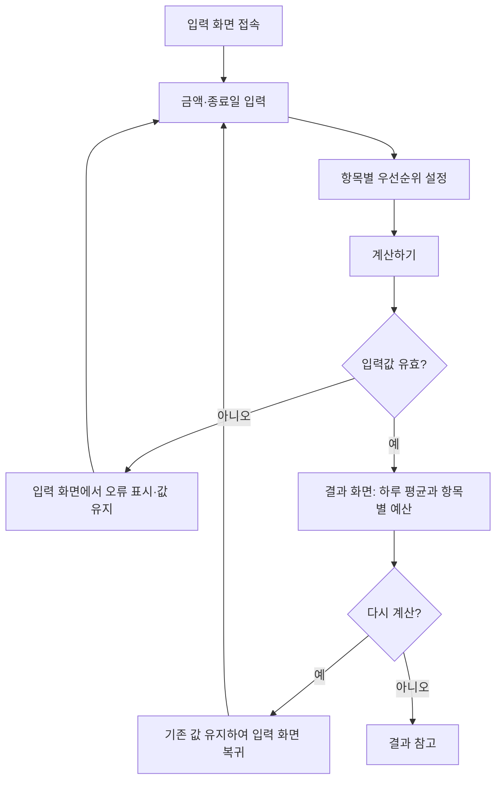
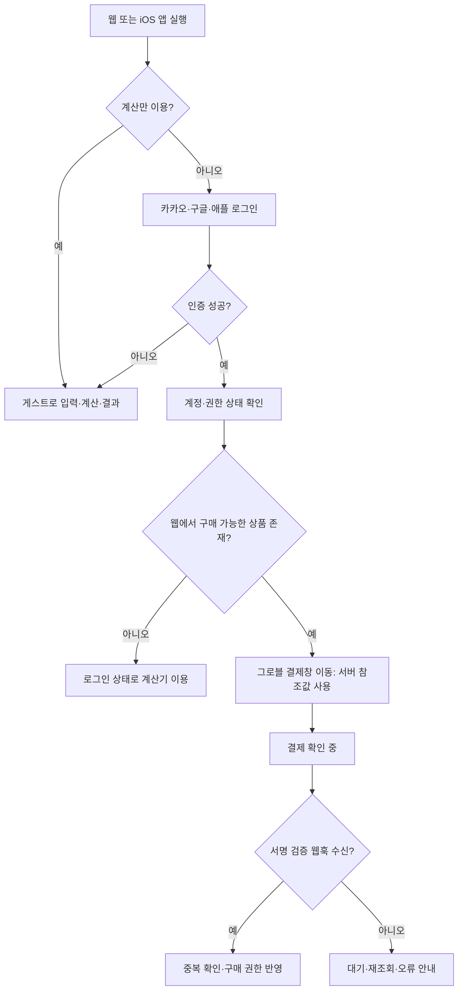
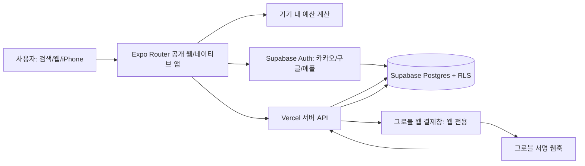

# PRD — 대학생 생활비 계산기 (웹 · iOS 서비스)

- **제품 형태:** 검색 가능한 모바일 우선 웹사이트 + iOS 네이티브 앱 (Expo Router 공통 코드베이스)
- **핵심 계산 화면:** 입력 화면, 결과 화면 (2개). 소셜 로그인·계정 관리·결제 관련 보조 화면은 별도.
- **동작 방식:** 예산 계산은 기기 내 규칙 기반으로 실행. 계정 인증·결제 권한 검증에 한해 백엔드 사용. 외부 AI 불필요.
- **운영 목표:** 초기 1,000명 이하의 사용자; 웹은 Vercel, iOS는 App Store에 별도 출시.
- **개발 기준:** 이 문서의 기능·처리 규칙·완료 조건을 우선 적용한다. 기존 시각 와이어프레임은 레이아웃·색감 참고용이다.
- **미확정:** 판매할 상품/유료 기능/가격, iOS에서의 그로블 결제 허용 방식. 이 결정 전에는 유료 결제 버튼을 출시하지 않는다.

## 1. 서비스 개요

### 목적
주 5일 등하교하는 대학생이 다음 용돈·아르바이트 수입을 받기 전까지 **식비·교통비·여가비에 나눌 금액**과 사용 종료일, 지출 우선순위를 입력하면 **항목별 총 권장 예산과 하루 평균 권장 예산**을 즉시 확인한다.

### 핵심 사용자·문제·행동·결과

| 구분 | 내용 |
|---|---|
| 사용자 | 주 5일 등하교하며 용돈이나 아르바이트 수입으로 생활하는 대학생 |
| 문제 | 남은 돈을 다음 수입일까지 식비·교통비·여가비에 얼마나 배분할지 판단하기 어려움 |
| 행동 | 배분 가능한 금액·종료일·1~3위 우선순위를 정한 뒤 **계산하기** 선택 |
| 결과 | 남은 일수, 전체 하루 평균, 항목별 총액·비율·하루 평균을 보여주는 예산 결과 |

**금액의 의미:** 입력 금액은 통장 전체 잔액이 아니다. 월세·통신비·정기결제 등 이미 다른 용도로 지출할 돈을 제외하고 **세 항목에 배분할 수 있는 금액**이다.

**핵심 계산 기능 범위 제외:** 계좌 연동, 실제 지출 기록·추적, 자동 저장, 공유·링크 복사, 푸시 알림, AI 추천, 평일 전용 계산, 분석 대시보드.

**신규 서비스 기능:** 카카오·구글·애플 소셜 로그인, 계정 및 탈퇴 처리, 향후 유료 기능의 구매 권한 관리, 그로블 웹 결제 연동(상품·가격 결정 및 iOS 정책 검토 후 활성화). **게스트도 계산기 이용 가능**하며 로그인은 계산의 선행 조건이 아니다.

## 2. 기능 요구사항

| ID | 필수 기능 | 동작 |
|---|---|---|
| FR-01 | 금액 입력 | 원 단위 정수 입력. 라벨 **세 항목에 나눌 생활비**와 다른 용도 비용 제외 안내 표시 |
| FR-02 | 종료일 선택 | 오늘부터 최대 365일 후까지 선택. **다음 수입일 전날**을 선택하도록 안내 |
| FR-03 | 우선순위 지정 | 식비·교통비·여가비를 각각 1·2·3위로 지정. 기본값은 식비→교통비→여가비 |
| FR-04 | 순위 맞교환 | 한 항목의 순위를 바꾸면 해당 순위에 있던 항목과 자동 교환. 중복 순위 금지 |
| FR-05 | 배분 비율 공개 | 계산 전부터 **1위 50%, 2위 30%, 3위 20%**를 표시. 이는 정해진 MVP 규칙이며 개인별 최적 비율이 아님 |
| FR-06 | 계산하기 | 클릭하면 입력 유효성 검사 후 정상일 때만 결과 화면 표시. 오류 시 입력 화면 유지 |
| FR-07 | 결과 표시 | 기간·일수, 전체 하루 평균, 항목별 순위·비율·총액·하루 평균 표시 |
| FR-08 | 결과 안내 | **권장 예산**임을 강조하고, 오늘·주말·공휴일 포함 평균이며 필수 비용을 보장하지 않음을 안내 |
| FR-09 | 다시 계산하기 | 입력 화면으로 돌아가 직전 금액·날짜·순위를 유지하고 수정 가능 |
| FR-10 | 오류 복구 | 문제가 있는 필드 아래 구체적 오류 안내, 첫 오류 필드로 포커스 이동, 다른 입력값 유지 |
| FR-11 | 뒤로 가기 | 결과에서 브라우저 뒤로 가기를 사용하면 입력 화면으로 돌아오며 현재 탭의 입력값 유지 |
| FR-12 | 날짜 변경 감지 | 결과를 열어 둔 채 한국 날짜가 바뀌면 기존 계산이 오래되었음을 안내하고 재계산 유도 |
| FR-13 | 게스트 사용 | 로그인하지 않아도 입력·계산·재계산 가능. 게스트 계산값은 서버에 전송·저장하지 않음 |
| FR-14 | 소셜 로그인 | 카카오·구글·애플 OAuth 로그인 지원(웹·iOS 각각 실제 기기로 검증). 실패·취소 시 계산 화면 유지 |
| FR-15 | 계정·탈퇴 | 로그인 상태 확인·로그아웃·앱 내 계정 삭제 요청 및 처리, 삭제 후 접근 차단 |
| FR-16 | 공개 페이지 SEO | 계산기 진입 페이지의 정적 HTML·제목·설명·canonical·robots.txt·sitemap.xml 제공; 사적 결과·계정 페이지는 noindex |
| FR-17 | 그로블 결제 준비 | 웹에서만 그로블 결제창 연결을 설계. 서버가 임의 참조값을 생성하여 주문에 연결하고 서명 검증 웹훅을 수신 |
| FR-18 | 결제 권한 반영 | 검증된 결제 완료에만 구매 권한 부여, 환불·구독 종료·결제 실패 시 권한 갱신, 중복 웹훅 멱등 처리 |
| FR-19 | 결제 대기·오류 | 결제 후 복귀만으로 구매 완료 처리하지 않음. 서버 확정 전 '결제 확인 중', 실패/지연/중복 알림 제공 |
| FR-20 | iOS 배포·정책 | iOS 네이티브 빌드 제공. 제3자 디지털 결제 허용 경로 미승인 시 iOS 결제·외부결제 유도 CTA 비활성화 |

## 3. 화면 구성

### 공통 흐름

**별도 계정·결제 흐름(핵심 계산 흐름을 막지 않음)**

> 유료 상품과 혜택은 미정이다. iOS 결제는 Apple 정책·결제 제공업체 승인 완료 전까지 위의 웹 구매 경로와 별도로 비활성화한다. 

### 화면 1 — 입력

1. 서비스명: **대학생 생활비 계산기**
2. 헤드라인: **다음 용돈일까지, 하루 얼마씩 쓸까?**
3. 금액 입력: 라벨 **세 항목에 나눌 생활비**, 힌트 **월세·통신비 등 다른 용도로 나갈 돈은 제외해 주세요.** 단위 원
4. 종료일: 라벨 **이 돈을 언제까지 쓸 건가요?**, 힌트 **12월 4일에 용돈을 받는다면 12월 3일을 선택하세요.**
5. 우선순위 선택: 식비·교통비·여가비 각각 1~3위 선택 및 실시간 적용 비율 표기. 순위 변경 시 두 항목 자동 맞교환
6. 주 버튼: **계산하기** (버튼은 활성 상태, 클릭 시 유효성 검사)
7. 오류: 각 문제 필드의 라벨·입력 요소 근처에 메시지, 첫 오류에 초점 이동. 유효한 값은 유지

**초기 상태:** 금액·종료일은 비어 있음. 순위만 기본값 설정. 예시 숫자를 실제 입력값으로 채우지 않음.

### 화면 2 — 결과

1. 헤더: **생활비 배분 결과**, 계산 기준일~종료일 및 총 일수
2. 대표 수치: **남은 N일 동안 하루 평균 권장 예산: 약 X원**
3. 항목 카드 3개: 1~3위 순서로 **항목명 / 순위 / 적용 비율 / 총 권장 예산 / 하루 평균 권장 예산** 표시
4. 고정 안내: **오늘·주말·공휴일을 포함한 달력상 일수로 나눈 평균입니다. 필수 비용 충족이나 실제 지출 반영을 보장하지 않습니다.**
5. 주 버튼: **다시 계산하기** (직전 입력 유지)
6. 계산 기준일이 바뀐 경우: **오늘 날짜가 바뀌었습니다. 다시 계산해 주세요.** 표시 후 재계산 유도

### 화면 참고 자료

> **구현 우선순위:** 본 문서의 화면 명세·처리 규칙이 이미지보다 우선한다. 이미지에는 이전 버전의 잘못된 연도 표기와 MVP 범위 밖인 **결과 링크 복사** 버튼이 있으므로 구현하지 않는다. 결과 문구는 **하루 사용 가능 금액** 대신 **하루 평균 권장 예산**을 사용한다.

### 보조 화면·상태 — 신규 요구사항

- **로그인 모달/화면:** 카카오·구글·애플 로그인 선택, 취소·오류 처리, 게스트 계산기 계속 사용. 웹과 iOS의 OAuth 복귀 경로를 각각 지원.
- **계정 화면:** 로그인 제공업체, 로그아웃, 계정 삭제 및 삭제 재확인. 결제 내역·권한 상태는 실제 상품이 정의된 경우에만 제공.
- **웹 결제 진입·결제 확인 화면:** 유료 상품·가격·혜택 결정 후 웹에 노출. 구매자는 그로블 결제창으로 이동하며, 귀환 즉시 구매 확정하지 않고 서버 웹훅 확인 상태를 보여줌.
- **iOS:** 계산과 계정 관리는 네이티브 UI를 사용하고, 디지털 유료 기능 결제 관련 버튼은 Apple의 허용 경로 승인 전 노출하지 않음.
- **화면 수 해석:** 종전 2개 화면 제한은 **핵심 계산 흐름**에만 적용한다. 필수 인증·계정 삭제·결제·법적 고지 등 보조 UI는 운영 서비스에서 별도로 존재할 수 있다.

### 화면·접근성 공통 조건

- 최소 320px 화면 폭에서 가로 스크롤 없이 입력·결과 확인 가능
- 금액 입력은 모바일 숫자 키패드 지원, 입력 라벨은 항상 보이도록 표시
- 모든 항목을 키보드로 선택 가능; Tab 이동 순서는 금액→날짜→순위→계산 버튼
- 오류는 색상 외에 텍스트로도 안내하고 해당 필드와 접근성 속성으로 연결
- 우선순위 변경 결과는 시각적으로 즉시 반영하고 보조기술에도 전달

## 4. 처리 규칙

### 입력·날짜 정책

| 변수 | 정책 |
|---|---|
| `amount` | **1~100,000,000원** 사이 정수. 쉼표·앞뒤 공백은 제거 후 검증; 음수·소수·문자·지수 표기 불가 |
| `endDate` | `YYYY-MM-DD`, **오늘~오늘+365일** 범위, 날짜 선택 필수 |
| `priority` | 세 항목에 1·2·3위가 각각 정확히 한 번씩 부여된 상태 |
| `today` | **계산 버튼을 누른 시점의 `Asia/Seoul` 날짜** |
| `days` | `today`부터 `endDate`까지 **양 끝 날짜 포함** 일수. 오늘 종료 시 1일 |

### 계산 알고리즘

1. 한국 날짜 기준으로 `days = 종료일 - 오늘 + 1`을 구한다. 자정·윤년 오류를 피하도록 **시각이 아닌 달력 날짜 기준**으로 계산한다.
2. `first = floor(amount × 50 / 100)`
3. `second = floor(amount × 30 / 100)`
4. `third = amount - first - second` (**남은 원 단위 잔액을 3위에 배분**)
5. 우선순위에 맞춰 세 항목에 금액을 매핑한다. 세 항목 총액의 합은 반드시 입력 금액과 동일해야 한다.
6. `overallDaily = floor(amount / days)`; `categoryDaily = floor(categoryAmount / days)`
7. 화면에는 **하루 평균 약 N원**으로 표시하고, 나눈 값이 1원 미만이면 **1원 미만**으로 표시한다. 각각 내림하므로 항목별 하루 평균 표시액의 합이 전체 하루 평균 표시액과 1~2원 다를 수 있다.

**중요:** `50:30:20`은 임시 배분 규칙이다. 실제 필수 교통비·식비를 충족하는지 계산하지 않는다. 사용자는 7일 기준 평균값을 평일 전용 한도로 이해하지 않도록 안내받아야 한다.

### 정상 예시

- 오늘: **2026-11-18** / 종료일: **2026-12-03** / 금액: **300,000원** / 일수: **16일**
- 우선순위: 식비 1위, 교통비 2위, 여가비 3위
- 결과: 식비 **150,000원(하루 9,375원)**, 교통비 **90,000원(하루 5,625원)**, 여가비 **60,000원(하루 3,750원)**
- 전체 하루 평균: **18,750원**

### 오류·상태 관리

| 상황 | 동작 및 안내 |
|---|---|
| 금액 비어 있음 | **세 항목에 나눌 금액을 입력해 주세요.** |
| 금액 0·음수·소수·문자 | **1원 이상의 정수 금액을 입력해 주세요.** |
| 금액 1억 원 초과 | **1억 원 이하로 입력해 주세요.** |
| 종료일 비어 있음 | **언제까지 사용할지 날짜를 선택해 주세요.** |
| 종료일 과거 | **오늘 또는 그 이후 날짜를 선택해 주세요.** |
| 종료일 365일 초과 | **오늘부터 365일 이내의 날짜를 선택해 주세요.** |
| 종료일 오늘 | 정상 계산, `days = 1` |
| 순위 중복 시도 | 자동 맞교환 및 변경된 순위 안내 |
| 결과→다시 계산/뒤로 가기 | 같은 탭 내 입력값 유지, 입력 화면으로 복귀 |
| 결과 화면 재방문 시 한국 날짜 변경 | 오래된 결과 안내 후 재계산 유도 |
| 페이지 새로고침/브라우저 종료 | 데이터 저장·복원 보장하지 않음 |

- 검증은 **계산하기 클릭 시** 반드시 수행한다. 필드에서 벗어날 때도 오류를 안내할 수 있지만 타이핑 도중 매 키 입력마다 오류를 표시하지 않는다.
- 정상 계산은 웹 브라우저 또는 iOS 기기에서 실행한다. **계산 API 호출 없이** 처리하며, 게스트 계산값은 서버에 저장·전송하지 않는다.
- 계정·결제 기능에만 Supabase 인증/DB 및 서버 웹훅을 사용한다. 로그인한 사용자에 대해서도 **예산 자동 저장은 구현하지 않는다**(후속 기능으로 별도 결정).
- 소셜 로그인 연결 시 동일 이메일만을 근거로 서로 다른 계정을 조용히 합치지 않는다. 계정 연결은 사용자 확인 절차를 따른다.
- 서버에서 승인되지 않은 유료 권한은 앱·웹 클라이언트 표시만으로 부여할 수 없다. DB Row Level Security(RLS)를 통해 사용자별 읽기/쓰기 권한을 검증한다.
- 결제 웹훅은 원본 요청 본문 기준 HMAC-SHA256 서명, 타임스탬프 허용 오차(±5분), 중복 방지 키를 확인한 뒤 처리한다. 웹훅 키/관리자 키는 서버 환경변수에만 보관한다.
- 결과 화면은 유효한 계산 데이터가 있을 때만 열 수 있다. 직접 접근하거나 상태가 소실된 경우 입력 화면으로 복귀시킨다.

## 5. 완료 조건

### 개발 인수 조건

- [ ] **AC-01** 입력 화면에서 배분 대상 금액의 의미와 다른 고정비 제외 안내를 확인할 수 있다.
- [ ] **AC-02** 종료일 선택 시 다음 수입일 전날을 고르도록 안내한다.
- [ ] **AC-03** 1~3위 설정과 `50/30/20` 비율을 계산 전에 확인할 수 있으며 중복 순위를 만들 수 없다.
- [ ] **AC-04** 정상 입력 시 결과 화면에 기간·일수·전체 하루 평균·세 항목의 비율·총액·하루 평균이 모두 표시된다.
- [ ] **AC-05** 항목별 총예산 합은 모든 허용 금액에 대해 입력 금액과 정확히 일치한다.
- [ ] **AC-06** 빈 금액·잘못된 금액·과거/범위 초과 날짜는 오류로 안내하고 입력값을 보존한다.
- [ ] **AC-07** **다시 계산하기** 또는 브라우저 뒤로 가기로 입력 화면에 돌아와 값을 수정할 수 있다.
- [ ] **AC-08** 결과 화면에서 예산의 '권장' 성격·주말 포함·필수 비용 미보장 안내가 보인다.
- [ ] **AC-09** 날짜 경계·윤년·한국 시간 자정 변경을 올바르게 처리한다.
- [ ] **AC-10** 모바일 320px 폭, 키보드 조작, 오류 메시지 접근성을 확인한다.
- [ ] **AC-11** 핵심 계산 화면은 2개이며 AI·계좌 연동·자동 저장·공유·소비 분석 기능은 없다. 필수 계정·결제 보조 화면은 별도다.
- [ ] **AC-12** 웹 공개 진입 페이지가 배포된 URL에서 실제 HTML 제목/설명·정적 콘텐츠·사이트맵·robots·canonical을 제공하고 Google Search Console에 사이트맵을 제출할 수 있다. 검색 순위/노출을 보장하지는 않는다.
- [ ] **AC-13** 웹·iOS에서 카카오·구글·애플 로그인이 각각 성공·취소·실패 케이스를 통과하고 게스트 계산을 막지 않는다.
- [ ] **AC-14** 앱에서 계정 삭제가 가능하고 인증·개인정보 삭제/보존 정책이 작동한다. 로그아웃 후 사적 정보 접근 불가.
- [ ] **AC-15** 결제 기능 출시 시, 그로블 서명 웹훅으로만 유료 권한을 부여하며 중복·환불·결제 지연·실패 시나리오를 검증한다.
- [ ] **AC-16** iOS 네이티브 화면이 작동하고 TestFlight 및 App Store 제출 준비를 완료한다. 한국 디지털 결제 허용 요건 충족 전에는 iOS 외부 결제 CTA를 노출하지 않는다.
- [ ] **AC-17** Vercel 운영 플랜이 상업적 사용 정책에 부합하고 비밀키가 앱 번들·공개 Git 저장소에 포함되지 않는다.

### 필수 QA 테스트

| ID | 입력 및 행동 | 예상 결과 |
|---|---|---|
| T-01 | 2026-11-18~12-03 / 300,000원 / 식비→교통비→여가비 | **16일**, 하루 **18,750원**, 총액 **150,000 / 90,000 / 60,000원** |
| T-02 | 100,001원 / 종료일 오늘 | **1일**, **50,000 / 30,000 / 20,001원**, 합계 일치 |
| T-03 | 교통비를 1위로 변경 | 기존 1위와 순위 맞교환 및 비율 재반영 |
| T-04 | 금액 공란·0·소수·음수·문자·상한 초과 | 적절한 인라인 오류, 다른 입력값 보존 |
| T-05 | 종료일 공란·어제·366일 후 | 오류 후 화면 1 유지, 날짜 수정 가능 |
| T-06 | 종료일 오늘 / 2026-12-31~2027-01-01 | 각각 **1일 / 2일** |
| T-07 | 2028-02-28~2028-03-01 | 윤년 기준 **3일** |
| T-08 | 1,000원 / 3일 | 전체 하루 **333원**, 항목별 합 **332원**, 항목 **총액** 합은 1,000원 |
| T-09 | 1원 / 16일 | 전체 하루 평균 **1원 미만**, 총액 1원 보존 |
| T-10 | 결과→다시 계산→수정→재계산, 브라우저 뒤로 가기 | 직전 값 유지, 새로운 결과로 정확히 갱신 |
| T-11 | 결과 화면을 다음 한국 날짜에 다시 활성화 | 이전 계산 경고, 재계산 가능 |
| T-12 | 모바일 320px·키보드·스크린리더 점검 | 가로 스크롤 없음, 모든 컨트롤·오류 안내 접근 가능 |
| T-13 | 검색엔진 크롤러로 웹 공개 페이지 조회 | 렌더된 HTML 제목·본문·설명 확인, 공개 URL만 사이트맵 포함 |
| T-14 | 웹·iOS에서 3종 OAuth 성공/취소/오류 | 정상 복귀·세션 유지·게스트 계산 유지 |
| T-15 | 탈퇴 후 로그아웃·재접근 | 삭제 요청 처리, 삭제 계정 데이터 보호, 재접근 차단 |
| T-16 | 위조 서명·만료 타임스탬프·중복 웹훅 | 권한 미발급 또는 중복 반영 방지 |
| T-17 | 결제 성공 복귀 페이지가 웹훅보다 먼저 로드 | `결제 확인 중` 안내, 웹훅 반영 후 권한 표시 |
| T-18 | 결제 환불·구독 갱신 실패·종료 이벤트 | 권한 정책에 따라 정확히 갱신, 주문 이력 추적 |
| T-19 | iOS 앱 실기기 및 심사 준비 | 네이티브 UI·로그인·접근성 확인, 승인 전 외부 디지털 결제 버튼 없음 |

## 6. 기술 스택 및 배포 아키텍처

### 6.1 선정 기준과 최종 구성

**결정:** **Expo + Expo Router + React Native + TypeScript**로 웹과 iOS를 함께 개발한다. 웹의 공개 페이지는 정적 렌더링(SEO), 계산은 클라이언트 로컬 처리, 사용자 인증·구매 상태는 **Supabase**, 웹 및 웹훅 서버는 **Vercel**, iOS 앱 바이너리는 **Expo EAS Build/Submit → Apple App Store**로 전달한다.

| 영역 | 선택 기술 | 역할 및 선택 근거 | 필수 여부 |
|---|---|---|---|
| 웹·iOS 공통 프레임워크 | **Expo (React Native) + Expo Router** | 한 프로젝트에서 모바일 앱·웹 라우팅 및 페이지 공유. iOS는 실제 네이티브 UI로 빌드하고 공개 웹 페이지는 정적 생성 | 필수 |
| 개발 언어 | **TypeScript** | 금액·날짜·우선순위·웹훅 상태의 자료형을 고정해 오류 방지 | 필수 |
| UI·스타일 | **React Native 컴포넌트 + StyleSheet/디자인 토큰** | 웹·iOS 공통 컴포넌트와 필요한 플랫폼별 UI 사용, 별도 웹 전용 CSS 프레임워크 없이 시작 | 필수 |
| 예산 계산 | **공통 TypeScript 순수 함수** | 50:30:20 및 날짜 계산을 웹·iOS에서 동일하게 실행, 서버·AI 불필요 | 필수 |
| 웹 검색 노출 | **Expo Router 정적 렌더링(SSG), Metadata, sitemap, robots** | 공개 페이지를 검색엔진이 읽을 수 있는 HTML로 제공. 색인/검색 순위는 보장하지 않음 | 필수 |
| 계정 인증 | **Supabase Auth** | 카카오·구글·애플 로그인, 세션 관리, OAuth 리디렉션 | 필수 |
| 데이터베이스 | **Supabase PostgreSQL + RLS** | 사용자 계정 연동, 주문·결제 이벤트·구매 권한을 안전하게 저장 | 필수(결제 활성화 시) |
| 서버·웹훅 | **Expo Router API Routes(서버 측) / Vercel Functions** | 결제 참조값 생성, 그로블 웹훅 원본 본문 검증, 주문/권한 반영. Vercel 배포 전 실제 지원 버전으로 통합 테스트 | 필수(결제 활성화 시) |
| 웹 배포 | **Vercel** | 정적 검색 페이지 호스팅 + 서버 기능. 실제 유료 운영 시 상업적 이용 가능한 플랜 선택 | 필수 |
| iOS 빌드/배포 | **Expo EAS Build/Submit + App Store Connect** | iOS 네이티브 앱 생성·TestFlight 테스트·앱 심사 제출(Vercel은 iOS 바이너리 배포처가 아님) | 필수 |
| 결제 | **그로블(Groble) 웹 결제창 + 웹훅** | 웹에서 결제하고 승인된 이벤트로 구매 권한 부여. 실제 판매 상품·가격과 iOS 결제 방식은 미정 | 조건부 필수 |
| 테스트 | **Vitest(계산 단위 테스트), Playwright(웹 흐름), iOS 실기기 QA** | 예산 함수, 유효성 검사, 로그인·결제 복귀, 앱 화면 검증 | 필수 |

> **대안:** Next.js 웹 + Expo iOS 두 프런트엔드를 사용하는 구조도 가능하지만 화면 구현·테스트가 이중화되므로 현재 인원·사용자 규모에선 공통 Expo Router 구성이 우선이다. 웹 중심의 복잡한 콘텐츠·서버 렌더링 기능이 늘어나면 재검토한다.

### 6.2 기술별 제약과 운영 조건

1. **SEO:** `/`의 소개/계산 시작 화면은 로그인 없이 정적 HTML을 제공하고 제목·설명·정규 URL(canonical)·Open Graph·robots·sitemap을 설정한다. 개인 결과·계정·결제 확인 페이지는 `noindex` 처리하고 사이트맵에서 제외한다. 검색 노출은 검색엔진의 색인 여부에 따라 달라진다.
2. **로그인:** 웹 OAuth와 iOS 네이티브/딥링크 복귀를 각각 구현하고 카카오·구글·애플 콘솔에서 Redirect URI를 허용 목록에 등록한다. iOS에서는 네이티브 Apple 로그인 경험을 우선 적용한다. 계정 생성 후 **앱 내 계정 삭제**를 제공한다. 비로그인 이용도 계속 가능하다.
3. **데이터:** Supabase `auth.users`를 기본 식별자로 사용한다. 별도 테이블(예: `profiles`, `purchase_intents`, `payments`, `webhook_events`, `entitlements`)은 실제 상품 및 권한 모델이 확정된 후 최소한으로 구현한다. 예산 계산 결과는 자동 저장하지 않는다. `user_id` 기준 RLS, 개인정보 최소 수집, 암호화 전송(HTTPS), 서버 전용 비밀키를 적용한다.
4. **결제:** 서버가 회원·주문 매핑용 **추측 불가능한 `sellerReference`**를 생성하고 DB에 저장한 뒤 그로블 결제창 URL의 `?ref=`로 전달한다. 사용자 ID·이메일·휴대전화번호를 참조값으로 쓰지 않는다. 결제 리디렉션은 결제 완료의 근거가 아니다.
5. **웹훅 보안:** 원본 요청 바이트로 `X-Groble-Signature`, `X-Groble-Timestamp` 검증(HMAC-SHA256, 허용 편차 ±5분), 이전 서명키 교체 대응, `X-Groble-Idempotency-Key` 중복 방지, 이벤트별 상태 전이를 구현한다. `payment.completed`/`subscription_payment.completed` 등 **확인된 결제 완료**에만 권한을 부여하고, 환불·실패·해지 이벤트에도 대응한다. 10초 안에 2xx 응답하도록 설계한다.
6. **iOS 결제 출시 차단 조건:** iOS 앱에서 소비되는 **디지털 기능·구독**의 그로블 결제는 Apple App Review 3.1 및 한국용 제3자 결제 권한에 따라 별도로 검토해야 한다. 한국의 관련 권한은 **한국 App Store에만 배포되는 별도 바이너리**, 지정된 승인 결제사업자 또는 Apple의 신규 PSP 승인, StoreKit 고지/보고 등의 요건이 있다. **그로블의 실제 하위 PG가 해당 요건으로 승인될지는 확인 필요**이며, 그로블 결제 링크를 앱에 그냥 넣는 것으로 허용되지 않는다. 승인 전 iOS의 구매·유도 버튼은 출시하지 않는다.
7. **App Store 완성도:** 앱을 웹뷰로만 감싸지 않는다. 기본 계산 UI는 iOS 네이티브 컴포넌트·날짜 선택·안전 영역·접근성으로 구현하고 앱 심사 가이드 4.2 최소 기능 요건에 맞도록 충분한 고유 사용자 가치를 확보한다.
8. **규모/비용:** 초기 1,000명 이하 수준에 Supabase의 무료 인증 MAU 한도(공식 안내 50,000 MAU)는 충분한 출발점이지만 이용 패턴·데이터 사용량에 따라 요금이 달라진다. **Vercel Hobby는 비상업적 개인용**이므로 실제 유료 서비스는 Pro 등 적합한 플랜을 사용한다. Apple Developer Program 가입비 및 그로블 판매 수수료가 별도로 발생한다.

### 6.3 서비스 운영 흐름

- **웹:** Vercel에 정적 공개 페이지와 서버 API 배포. SEO 공개 URL은 크롤러/사이트맵 확인.
- **iOS:** EAS로 서명된 네이티브 앱 생성 후 TestFlight, App Store Connect 제출. Vercel API와 Supabase를 사용하며 iOS 결제 기능은 별도 승인 조건 충족 후 활성화.
- **기본 계산:** 네트워크 연결과 로그인 없이도 계산이 동작하도록 설계. 계정·결제 상태만 연결이 필요.

### 6.4 확정이 필요한 비즈니스 요구사항

| 결정 항목 | 현재 상태 | 개발/출시 영향 |
|---|---|---|
| **판매할 유료 상품·기능·혜택** | 미정 | 가격·상품 ID·구매 권한/만료 정책·결제 CTA를 결정할 수 없어 **유료 출시 보류** |
| **단건 결제 또는 정기구독** | 미정 | 환불·갱신·해지·재시도 로직, 웹훅 이벤트 범위 결정 필요 |
| **그로블의 iOS 한국 제3자 결제 PSP 승인 여부** | 확인 필요 | iOS에서 그로블을 통한 디지털 기능 구매 버튼 출시 가능 여부 결정 |
| **로그인 후 예산 저장/동기화** | 이번 버전에서 제외 | 소셜 로그인은 계정·결제 권한 확인 용도이며 계산은 게스트에게도 제공 |
| **앱 제공 국가·언어** | 기본 한국어, 한국 대상 가정 | 한국 외 App Store 결제 정책 및 로그인 설정이 달라질 수 있음 |

### 6.5 구현 순서

1. 공통 TypeScript 예산 계산 함수·자동 테스트 → 입력·결과 네이티브/웹 공통 UI 구현
2. 공개 웹 정적 렌더링·메타데이터·사이트맵 구성 → Vercel 배포 및 크롤러 검증
3. Supabase 프로젝트·RLS·카카오/구글/애플 인증 → 웹·iOS 기기별 로그인 및 계정 삭제 테스트
4. iOS EAS 빌드·TestFlight 검증 → App Store 심사 준비
5. **유료 상품 정의 및 iOS 결제 정책 검토 완료 후** 그로블 결제창·Vercel 웹훅·주문/권한 DB·취소/환불 테스트 → 웹 유료 기능 출시 → iOS 허용 경로 별도 적용

### 6.6 개발 시 참고할 공식 기술 문서

- Expo Router 웹·iOS: https://docs.expo.dev/router/introduction/
- Expo 웹 정적 렌더링 및 SEO: https://docs.expo.dev/router/web/static-rendering/
- Expo API Routes의 Vercel 배포: https://docs.expo.dev/router/web/api-routes/
- Expo App Store 배포: https://docs.expo.dev/deploy/submit-to-app-stores/
- Supabase Auth: https://supabase.com/docs/guides/auth
- Supabase 요금: https://supabase.com/pricing
- Vercel Hobby 사용 제한: https://vercel.com/docs/plans/hobby
- 그로블 결제창: https://www.groble.im/help/guides/payment-window
- 그로블 웹훅: https://www.groble.im/help/guides/webhook
- Apple 한국 제3자 결제 정책: https://developer.apple.com/support/storekit-external-entitlement-kr/
- Apple 앱 심사·계정 삭제 정책: https://developer.apple.com/kr/app-store/review/guidelines/
